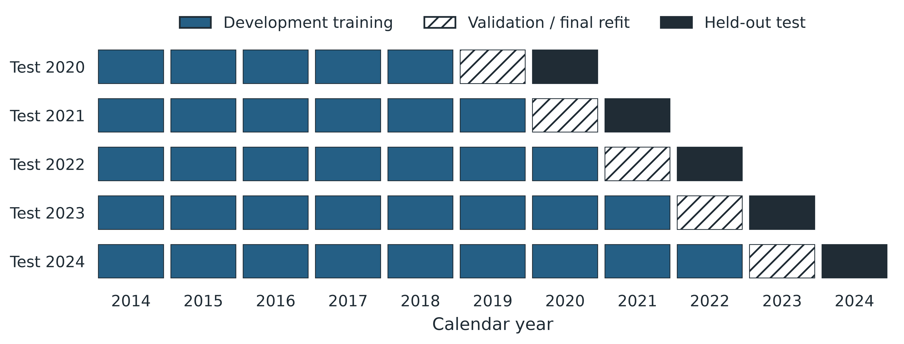

# Weather-aware maize yield prediction and within-environment hybrid selection can diverge: a five-year retrospective benchmark

*Unpublished research manuscript - draft for scientific review, 19 October 2026. Author names, affiliations, declarations and target-journal formatting are not yet supplied.*

## Abstract

Absolute-yield prediction and within-environment hybrid selection are distinct objectives, but model improvements are often assessed primarily by yield error. We examined whether added weather information improved both objectives in a retrospective analysis of public Genomes to Fields maize trials. Five forward-year test folds (2020-2024) contained 57,673 scored environment-hybrid observations across 129 environment-years. Using matched held-out predictions, we compared a genetic-and-static CatBoost pipeline (W0), its 120-day observed-weather counterpart (W120), and an exploratory extension with vapor-pressure-deficit and heat-load proxies. We evaluated within-environment top-20% recall and root mean squared error (RMSE), and decomposed mean squared error into environment-mean and centered within-environment components. W120 increased recall from 0.2872 to 0.2977 (+1.05 percentage points), although the crossed year/site-code sensitivity interval ranged from -0.38 to +2.89 percentage points. RMSE decreased from 2.5332 to 2.5149 Mg/ha; most of the point-estimated squared-error reduction reflected improved calibration of environment means. The stress extension further lowered RMSE to 2.5020 Mg/ha but reduced recall to 0.2913, with sensitivity intervals spanning zero. In these fitted pipelines, lower yield error was therefore insufficient evidence of better hybrid selection. The analysis is exploratory and does not establish new-site transfer or pre-planting utility.

**Keywords:** maize; genomic prediction; multi-environment trials; weather; hybrid selection; model evaluation

## 1. Introduction

Selecting maize hybrids for a target environment is not identical to predicting their absolute grain yields. An absolute-yield model can improve by estimating whether an environment is generally productive, even if it changes little about which hybrids rank highest within that environment. Conversely, a model can discriminate among hybrids but miss the environment's overall yield level. The distinction matters when a prediction study invokes breeding selection as its practical motivation but optimizes only pooled or environment-averaged yield error.

Public Genomes to Fields (G2F) trials provide genetic, phenotypic, metadata and environmental records for studying this distinction (Genomes to Fields, 2025; Chen et al., 2026). Prior studies have already combined genomic and environmental information, used time-resolved weather features and examined genotype-by-environment interactions. Rogers and Holland (2022) found that environment-specific prediction depended strongly on environmental similarity between training and test data. Westhues et al. (2021) used genomic and phenology-aligned environmental predictors in boosting models. Fernandes et al. (2024) compared additive and interaction-oriented machine-learning representations in G2F trials. We therefore do not claim novelty from adding weather, applying CatBoost, or measuring within-environment prediction.

The question here is narrower and decision-oriented: when a fixed predictive pipeline receives additional weather-derived information, does its apparent improvement in absolute-yield error translate into better identification of high-yielding hybrids in the same held-out trial environments? A second question is whether an agronomically interpretable stress representation that receives model attribution supplies *incremental* prediction or selection value. This requires matched baselines and explicit uncertainty; feature importance alone cannot answer either question.

We analyze five forward-year test folds with a no-post-planting-weather baseline, a cumulative 120-day weather model and a separately specified exploratory VPD/heat augmentation. We then decompose squared prediction error into between-environment calibration and within-environment discrimination terms, and evaluate top-20% recall for the selection task. The original experiment was designed around environment-averaged RMSE; the selection-centered synthesis and error decomposition were formulated after examining model results. Accordingly, the present paper is a retrospective, exploratory analysis of saved test predictions, not a prospective confirmation of a newly registered hypothesis.

## 2. Materials and methods

### 2.1. Trial data and evaluation population

We used the public G2F 2024 maize genotype-by-environment prediction release, including historical trials from 2014-2023 and the subsequently released 2024 outcomes (Genomes to Fields, 2025; Chen et al., 2026). The response was observed grain yield in Mg/ha for an environment-hybrid combination. For historical trials, positive finite plot yields were arithmetically averaged within that combination; the released 2024 environment-hybrid target was retained. This is not a field-design-adjusted best linear unbiased estimate (BLUE), which limits direct comparison with studies using mixed-model adjustment.

Eligibility required a linked genotype, trial environment, site code, resolved planting date and calendar coverage through 120 days after planting. The same eligible rows were used in paired model comparisons. The five test years, 2020-2024, contained 57,673 scored observations in 129 environment-years and 31 distinct site codes. Site codes are imperfect proxies for physical locations. The 2024 release contained 10,057 prediction inputs in 23 environments; 9,486 observations in 22 environments had released targets and entered scored comparisons. The other 571 inputs were retained as prediction inputs but could not contribute to accuracy metrics.

### 2.2. Predictors and model families

W0 included 100 principal components from 2,425 numerical genetic markers, latitude, longitude, coordinate-missingness indicators, planting day of year and one-hot site code. Marker imputation, principal-component analysis, static imputation and category vocabularies were fitted on training data only. The same genetic and static representation was compared across models; environment identifier, year and yield-derived diagnostics were not predictors.

W120 added 30 summaries of observed daily weather over the half-open interval from planting day through day 119: 21 physical summaries of temperature, precipitation, radiation, relative humidity and wind, plus nine data-quality summaries. Missing weather sentinels were treated as missing; bounded interpolation and training-derived medians were used within the horizon. The day-120 horizon is retrospective: the study did not validate access to this weather before planting or a real-time forecast service.

The original benchmark compared Ridge regression, extremely randomized trees and CatBoost (Prokhorenkova et al., 2018) against their own W0 baselines. Each model-window pair selected between two prespecified hyperparameter candidates on the immediately preceding year. Ridge used training-fitted standardization; Extra Trees used 160 trees; CatBoost used 600 iterations, learning rate 0.05, L2 leaf regularization 5 and a depth choice of 6 or 8. The focal W120 CatBoost model was the best point-estimate RMSE member of this limited benchmark, but its selection after inspection makes any cross-family winner claim exploratory. The stress extension kept that model's cohort and search budget fixed and appended only three nonlinear summaries of existing temperature/humidity data: mean and 90th-percentile daily VPD proxies, and accumulated heat excess above 35 degrees C. They are not independently measured canopy VPD or new environmental data.

### 2.3. Temporally ordered predictions and analysis chronology

For a test year t in 2020-2024, development fitting used 2014 through t-2, hyperparameter choice used t-1, and the final model was refitted on all observations through t-1 before predicting t. Preprocessing followed the same boundaries to respect structured temporal validation (Roberts et al., 2017). The saved W0 and W120 predictions originated in the prior frozen benchmark; the VPD/heat candidate was fitted in a separate extension after the baseline results were known. Candidate predictions and hashes were frozen before joining corresponding held-out outcomes in that extension. These safeguards prevent within-fold test-label use, but they cannot erase the post-hoc choice of follow-up question. The rolling design is summarized in Fig. 1.

### 2.4. Outcomes and decomposition

Within each environment-year, RMSE was calculated from observed and predicted yields, then averaged equally across environments within the year and equally across the five years. The main original experiment optimized this absolute-yield metric. For selection, let n be the number of scored hybrids within an environment and k = ceiling(0.20n). The k highest observed yields define the true top group; the k highest predictions define the selected group. Top-20% recall is their overlap divided by k. Boundary ties receive fractional expected-inclusion weights. The five-year summary again gives equal weight to environments within a year and then to years. With equal-sized selected and true sets, this measure is also top-k precision; it is not general classification accuracy. Random selection has an expected recall near 0.20.

For a given environment, the exact squared-error identity is

MSE = (mean predicted yield - mean observed yield)^2 + mean{[(prediction - mean prediction) - (observation - mean observation)]^2}.

The first term is squared environment-level calibration error. The second is centered within-environment MSE; it measures discrimination in yield deviations but is not itself a ranking metric. We calculated each term on the same saved test predictions, averaged using the same environment/year weights, and compared paired models. The reported 92.9% is the first term's share of a point-estimated MSE difference, not a share of causal weather influence. RMSE cannot be decomposed linearly this way, so the component analysis is explicitly secondary to the original primary RMSE outcome.

We report annual signs, a five-year point estimate and 2,000-draw year-block and crossed year/site-code resampling sensitivity intervals for paired differences. The crossed intervals account descriptively for repeated site codes and years but condition on the fitted predictions. With only five test years, overlapping training histories, multiple inspected contrasts and site codes that may not uniquely identify farms, they should not be interpreted as calibrated prospective confidence guarantees or confirmatory significance tests.

### 2.5. Exploratory model explanation

TreeSHAP was applied to five randomly selected scored hybrids per environment-year from the stress-augmented CatBoost model (645 rows in 129 environment-years). Mean absolute attribution was summarized with equal environment and year weights. An additional exact pairwise-interaction calculation involved 44 scored hybrids in the 22 environments of 2024 only. These explanations describe the fitted model's allocation of predictions among correlated features; they do not estimate the causal impact of VPD or establish a physiological threshold (Lundberg and Lee, 2017).

## 3. Results

### 3.1. Weather modestly improved selection over the non-weather model

The CatBoost W0 model achieved a year-equal, environment-equal top-20% recall of 0.2872, compared with 0.2977 for W120. The paired difference was +1.05 percentage points, positive in each of the five years (Table 1; Fig. 2). The year-block 95% resampling interval was +0.44 to +1.74 percentage points; the more conservative crossed year/site-code sensitivity interval was -0.38 to +2.89 percentage points. The latter spans zero, so the observed directional consistency does not establish reliable transfer to new physical sites. W120's absolute-yield RMSE was 2.5149 Mg/ha versus 2.5332 Mg/ha for W0, a 0.72% point-estimate reduction; its crossed RMSE-difference interval was -0.213 to +0.165 Mg/ha. The mean recall of 0.2977 exceeds the approximately 0.20 random-selection reference in these observed trials, but the incremental weather gain should be judged against W0, not against random selection alone.

| Test year | W0 top-20% recall | W120 top-20% recall | W120 + stress recall | W120 RMSE | W120 + stress RMSE |
| --- | ---: | ---: | ---: | ---: | ---: |
| 2020 | 0.2349 | 0.2389 | 0.2350 | 2.2178 | 2.1850 |
| 2021 | 0.3477 | 0.3570 | 0.3612 | 2.3510 | 2.3436 |
| 2022 | 0.2213 | 0.2351 | 0.2238 | 2.8554 | 2.8808 |
| 2023 | 0.3365 | 0.3388 | 0.3361 | 2.4570 | 2.4429 |
| 2024 | 0.2956 | 0.3187 | 0.3004 | 2.6934 | 2.6578 |
| Year-equal mean | 0.2872 | 0.2977 | 0.2913 | 2.5149 | 2.5020 |

**Table 1.** Held-out annual selection and yield-error outcomes for the focal CatBoost pipelines. Recall is averaged equally over environments within each year; the final row gives each year equal weight. RMSE is in Mg/ha. Values are rounded display numbers; inference and decompositions use unrounded saved predictions.

### 3.2. Most of the W0-to-W120 squared-error reduction came from environment calibration

The year-equal mean MSE difference for W120 minus W0 was -0.2775 (Mg/ha)^2. Squared environment-mean error changed by -0.2577 (Mg/ha)^2 and centered within-environment MSE by -0.0198 (Mg/ha)^2. Thus 92.9% of the point-estimated MSE reduction was attributable to environment-mean calibration (Table 2; Fig. 3). Centered MSE improved in all five test years, so the result is not literally *zero* within-environment benefit. Rather, the benefit was small compared with the overall environment-level correction, consistent with the modest increase in top-20% recall.

| Paired contrast | Change in mean MSE | Change in squared environment-mean error | Change in centered within-environment MSE | Change in top-20% recall |
| --- | ---: | ---: | ---: | ---: |
| W120 minus W0 | -0.2775 | -0.2577 | -0.0198 | +0.0105 |
| W120 + stress minus W120 | -0.1046 | -0.1081 | +0.0035 | -0.0064 |

**Table 2.** Exact decomposition of paired point-estimate MSE changes. MSE components are in (Mg/ha)^2; negative values improve squared error. Recall changes are fractions; positive values improve top-20% selection. These are retrospective diagnostics, not causal contributions or independent confirmatory tests.

### 3.3. Stress proxies reduced the point-estimated RMSE without improving selection

Adding the three VPD/heat proxies changed CatBoost's year-equal RMSE from 2.5149 to 2.5020 Mg/ha, a 0.51% reduction. The crossed year/site-code sensitivity interval for candidate-minus-reference RMSE was -0.0628 to +0.0338 Mg/ha, including zero. Top-20% recall fell from 0.2977 to 0.2913, a -0.64-percentage-point point estimate, with only one of five years favorable. The crossed recall-difference interval was -1.81 to +0.59 percentage points (Fig. 4). This is an observed divergence between two evaluation targets, not a demonstrated general population-level deterioration.

The MSE decomposition gives a more precise diagnosis of that divergence. The augmented model reduced squared environment-mean error by 0.1081 (Mg/ha)^2, while centered within-environment MSE increased by 0.0035 (Mg/ha)^2. The latter worsened in four of five years. The calibration improvement was therefore larger than the total MSE improvement and offset deterioration in the discrimination component. These terms identify where the model's point-estimated error changed; they do not reveal the physiological mechanism responsible.

### 3.4. Attribution did not establish incremental utility or a stress threshold

Across the 645 sampled held-out observations, the p90 VPD proxy ranked 11th of 182 candidate-model features by year- and environment-equal mean absolute SHAP attribution (0.099 Mg/ha; Fig. 5). Mean VPD ranked 26th (0.042 Mg/ha), heat excess 48th (0.019 Mg/ha), and the pre-existing hot30-days feature ranked 3rd (0.251 Mg/ha). The model therefore used the added variables, but attribution is not evidence that they improved prediction or selection relative to the matched W120 baseline. Environmental-feature redundancy is substantial: across the 129 environment-year means, Spearman correlations were 0.977 for mean versus p90 VPD and 0.988 for heat excess versus the pre-existing hot35-days feature. The small pairwise-interaction sample in 2024 is diagnostic only; no universal VPD-by-heat or genotype-by-stress threshold is claimed.

## 4. Discussion

### 4.1. The principal insight is an evaluation-target mismatch

The observed models did better than chance at recovering the true highest-yielding fifth of hybrids in the same trial environments. That is a meaningful empirical result, but the more relevant question for an added information source is whether it improves on an informative model already available. W0 combined genetic structure, planting information and static site descriptors, achieving a top-20% recall of 0.2872 without post-planting weather. W120 increased this by only 1.05 percentage points, with geographical sensitivity that did not rule out zero. By contrast, the VPD/heat extension slightly reduced absolute-yield RMSE while lowering observed recall. This shows why a lower RMSE alone is insufficient evidence for improved selection under the tested cohort and pipeline.

The exact squared-error identity makes the distinction operational. Environment-wide calibration and within-environment discrimination are separately measurable. The former dominated the W0-to-W120 MSE improvement and more than accounted for the stress extension's MSE improvement. A breeding-oriented evaluation should therefore report a selection endpoint alongside absolute-yield error, especially when all hybrids in a target environment share much of their environmental feature vector. Centered MSE and rank-based top-k recall answer related but nonidentical questions: the former uses the magnitude of relative yield deviations, while the latter asks whether a restricted selection set contains the truly highest-yielding materials.

### 4.2. Relation to previous genomic prediction work

The result does not contradict evidence that environmental covariates can help maize genomic prediction. Prior G2F studies differ in cohorts, marker encoding, environmental representation, relatedness structure and validation design (Rogers and Holland, 2022; Westhues et al., 2021; Fernandes et al., 2024). Several use prediction correlations rather than the present year-equal mean of environment-level RMSE or top-20% recall. Jarquín et al. (2014) established reaction-norm modeling, and Jarquin et al. (2021) found that a particular climatic covariate representation did not consistently add predictive value in G2F combining-ability models. The present analysis is a conditional benchmark of three saved CatBoost pipelines, not a claim that weather or G x E interactions are generally unimportant or that our algorithms outperform established breeding models.

### 4.3. Limits of inference and deployment

The most important limitation is chronology. The original project selected absolute-yield RMSE as its primary endpoint; the decision-centered synthesis followed inspection of results, and the stress-feature extension was also subsequent. Its fixed comparison rules and locked prediction files improve auditability but do not make the question blind or prospectively confirmed. The year/site-code intervals condition on already-fitted models and only five years. Physical sites may not map one-to-one to codes; annual training sets overlap; and there was no deliberately held-out new-location cohort. Consequently, we cannot assert reliable future-site improvement, statistical superiority under a multiplicity-controlled trial, or a reproducible biological VPD threshold.

The scored sample was selected for full 120-day calendar coverage and observed yield, which limits generalization to incomplete or unlabelled trials. Outcomes were simple environment-hybrid means rather than field-design-adjusted BLUEs. Repeated hybrids and sites may make within-sample selection easier than selection of entirely new germplasm and new physical locations. The available genuinely unseen-site subset was sparse, and no claim of robust spatial transfer follows. Weather through 120 days after planting is unavailable before planting. Thus these predictions could support only a retrospective or suitably timed in-season decision scenario; they are not a validated pre-planting deployment tool.

Finally, the comparisons omit genomic best linear unbiased prediction, reaction-norm, factor-analytic and phenology-aware alternatives. The three appended stress variables are nonlinear transformations of an existing daily weather source. SHAP rankings in correlated predictors do not measure independent feature utility or causal effects. Future work should evaluate a locked new-year/new-location test, true prediction-time weather availability, field-design-adjusted targets where possible, and models optimized directly for within-environment selection. Those experiments must be treated as future hypotheses, not as findings of this study.

## 5. Conclusion

In this retrospective benchmark, adding observed weather produced a small point-estimate gain in within-environment top-20% recall, but the crossed year/site-code sensitivity interval did not exclude zero. Most of the accompanying squared-error reduction reflected better calibration of environment means rather than substantially better discrimination among hybrids within an environment. The exploratory VPD/heat extension further illustrated the distinction: RMSE decreased while observed selection recall declined. Breeding-oriented prediction studies should therefore evaluate the selection decision alongside absolute-yield error, rather than use RMSE improvement as its proxy. Independent new-year and new-location tests, with weather available at the intended decision time, are needed before claiming operational selection value.

## Declarations and data availability

**Data availability:** The input dataset is publicly catalogued by Genomes to Fields at doi:10.25739/78mn-4394. The analytical cohort, saved predictions, protocols and verification scripts are retained in the accompanying project workspace. No public archival code DOI or repository URL is asserted in this draft.

**Ethics:** No human participants or animals were studied in this secondary analysis of public crop-trial data.

**Author contributions, funding, competing interests and acknowledgements:** To be confirmed by the submitting author before any external submission. No declarations are inferred from the dataset providers or this draft.

## References

1. Chen, Q., Washburn, J. D., Lima, D. C., Romay, M. C., Gage, J. L., Holland, J. B., et al. (2026). Genomes to fields 2024 maize genotype by environment prediction competition. *BMC Research Notes*, 19, 113. https://doi.org/10.1186/s13104-026-07629-5
2. Fernandes, I. K., Vieira, C. C., Dias, K. O. G., et al. (2024). Using machine learning to combine genetic and environmental data for maize grain yield predictions across multi-environment trials. *Theoretical and Applied Genetics*, 137, 189. https://doi.org/10.1007/s00122-024-04687-w
3. Genomes to Fields. (2025). *Genomes to Fields 2024 Maize Genotype by Environment Prediction Competition* [Data set]. CyVerse Data Commons. https://doi.org/10.25739/78mn-4394
4. Jarquín, D., Crossa, J., Lacaze, X., Du Cheyron, P., Daucourt, J., Lorgeou, J., et al. (2014). A reaction norm model for genomic selection using high-dimensional genomic and environmental data. *Theoretical and Applied Genetics*, 127, 595-607. https://doi.org/10.1007/s00122-013-2243-1
5. Jarquin, D., de Leon, N., Romay, C., Bohn, M., Buckler, E. S., Ciampitti, I., et al. (2021). Utility of climatic information via combining ability models to improve genomic prediction for yield within the Genomes to Fields maize project. *Frontiers in Genetics*, 11, 592769. https://doi.org/10.3389/fgene.2020.592769
6. Lundberg, S. M., and Lee, S.-I. (2017). A unified approach to interpreting model predictions. *Advances in Neural Information Processing Systems*, 30. https://proceedings.neurips.cc/paper/2017/hash/8a20a8621978632d76c43dfd28b67767-Abstract.html
7. Prokhorenkova, L., Gusev, G., Vorobev, A., Dorogush, A. V., and Gulin, A. (2018). CatBoost: unbiased boosting with categorical features. *Advances in Neural Information Processing Systems*, 31, 6638-6648. https://proceedings.neurips.cc/paper/2018/hash/14491b756b3a51daac41c24863285549-Abstract.html
8. Roberts, D. R., Bahn, V., Ciuti, S., Boyce, M. S., Elith, J., Guillera-Arroita, G., et al. (2017). Cross-validation strategies for data with temporal, spatial, hierarchical, or phylogenetic structure. *Ecography*, 40, 913-929. https://doi.org/10.1111/ecog.02881
9. Rogers, A. R., and Holland, J. B. (2022). Environment-specific genomic prediction ability in maize using environmental covariates depends on environmental similarity to training data. *G3 Genes|Genomes|Genetics*, 12, jkab440. https://doi.org/10.1093/g3journal/jkab440
10. Westhues, C. C., Mahone, G. S., da Silva, S., Thorwarth, P., Schmidt, M., Richter, J.-C., et al. (2021). Prediction of maize phenotypic traits with genomic and environmental predictors using gradient boosting frameworks. *Frontiers in Plant Science*, 12, 699589. https://doi.org/10.3389/fpls.2021.699589
